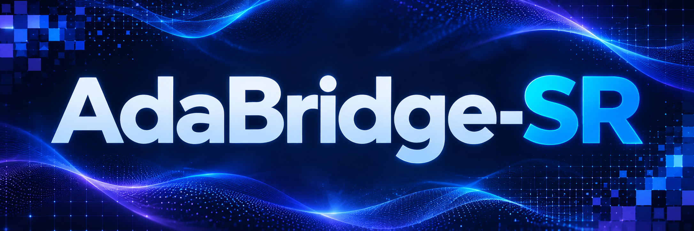

# AdaBridge-SR: Adaptive Bridge Matching for Real-World Image Super-Resolution
<div align="center">



**ECCV 2026**

[](https://link.springer.com/chapter/10.1007/978-3-032-37461-5_33)

</div>

Official implementation of **AdaBridge-SR: Adaptive Bridge Matching for Real-World Image Super-Resolution** ([ECCV 2026](https://link.springer.com/chapter/10.1007/978-3-032-37461-5_33)).

## :wrench: Environment

A CUDA GPU is required for inference and training.

```bash
conda env create -f environment.yml
conda activate adabridge-sr
pip install torch==2.5.1 torchvision==0.20.1 --index-url https://download.pytorch.org/whl/cu121
pip install -r requirements.txt
```

## :rocket: Quick Inference

### 1. Prepare the pretrained models

Download `stable-diffusion-2-1-base` in Diffusers format, including the `*.safetensors` weights, and set its local path:

```bash
export SD_PATH=/path/to/stable-diffusion-2-1-base
```

Download `final.tar.gz` from [GitHub Releases](https://github.com/W-JG/AdaBridge-SR/releases) and extract it into `weights/`:

```bash
wget https://github.com/W-JG/AdaBridge-SR/releases/latest/download/final.tar.gz
tar -xzf final.tar.gz -C weights
```

This creates:

```text
weights/final/
├── unet_lora_adapter/
│   ├── adapter_config.json
│   └── adapter_model.safetensors
├── vae_encoder_lora_adapter/
│   ├── adapter_config.json
│   └── adapter_model.safetensors
└── trajectory_control_predictor.pt
```

See [weights/README.md](weights/README.md) for the checksum.

### 2. Prepare the testing images

Prepare a single image or a directory containing `.png`, `.jpg` or `.jpeg` images.

### 3. Run inference

```bash
# One-step inference
bash scripts/infer.sh --input_image /path/to/lq_images --output_dir outputs/s1

# Two-step inference
bash scripts/infer.sh --input_image /path/to/lq_images --output_dir outputs/s2 --num_infer_steps 2
```

The scripts run from the repository root, so relative paths are resolved against it. The default settings use x4 upscaling, BF16 and AdaIN color correction. Inference settings are in `configs/infer.yml`, and any of them can be overridden on the command line (for example `--upscale 2` or `--device cuda:1`). Both modes use the same checkpoint.

## :hugs: Training

### 1. Prepare the training data

Set `TRAIN_DATA` to a directory containing HQ training images or a `.txt` file listing one image path per line:

```bash
export TRAIN_DATA=/path/to/train_images_or_list.txt
```

Online degradation settings are provided in `dataset/params_realesrgan.yml`.

### 2. Prepare the pretrained models

Set `SD_PATH` as described above. Download [DINOv3 ConvNeXt-Large](https://github.com/facebookresearch/dinov3) and place the weight at:

```text
dinov3_gan/dinov3_weights/dinov3_convnext_large_pretrain_lvd1689m-61fa432d.pth
```

### 3. Start training

```bash
bash scripts/train.sh
```

Training starts from SD2.1-base at step 0. The LoRA adapters and the trajectory controller are trained jointly with multiple timesteps, bridge noise and trajectory control from the first step, for 8000 steps. The settings are in `configs/train.yml`.

By default, `scripts/train.sh` runs on 4 GPUs with a batch size of 1 per GPU and gradient accumulation of 4, i.e. an effective batch size of 16, as used for the released model. To use a different number of GPUs, set `NUM_GPUS` and adjust `gradient_accumulation_steps` in the config to keep the effective batch size at 16:

```bash
NUM_GPUS=2 bash scripts/train.sh   # with gradient_accumulation_steps: 8
```

## :bar_chart: Evaluation

Install the evaluation dependencies:

```bash
pip install -r requirements-eval.txt
```

For paired datasets, provide SR and GT images with matching filename stems:

```bash
bash scripts/evaluate.sh --inp_imgs outputs/s1 --gt_imgs /path/to/gt \
    --dataset_names RealSR --model_name AdaBridge-SR --log outputs/metrics
```

For datasets without GT:

```bash
bash scripts/evaluate.sh --inp_imgs outputs/s1 --gt_imgs None \
    --dataset_names RealLQ250 --model_name AdaBridge-SR --log outputs/metrics
```

Supported metrics: PSNR/SSIM (Y channel), LPIPS, DISTS, CLIPIQA, NIQE, MUSIQ, MANIQA, CLIPIQA+ and TOPIQ-NR. Metric weights may be downloaded on first use. Results are saved as CSV files under the specified log directory.

## :book: Citation

If you find this work useful, please cite:

```bibtex
@inproceedings{wang2026adabridge,
  title     = {AdaBridge-SR: Adaptive Bridge Matching for Real-World Image Super-Resolution},
  author    = {Wang, Jiangang and Sun, Shangquan and Zhang, Aiping and Cui, Yuning and Ren, Wenqi},
  booktitle = {Computer Vision -- ECCV 2026},
  pages     = {602--619},
  year      = {2026},
  publisher = {Springer},
  address   = {Cham},
  doi       = {10.1007/978-3-032-37461-5_33}
}
```

## :page_facing_up: License

The code is released under the [Apache License 2.0](LICENSE). The AdaBridge-SR weights are trained on Stable Diffusion 2.1-base and are subject to the use restrictions of the CreativeML Open RAIL++-M License. The DINOv3 weights used for training are subject to the DINOv3 License. Third-party code keeps its original license headers, and the corresponding license texts are in [licenses/](licenses).

## :thumbsup: Acknowledgement

This project is built upon [OMGSR](https://github.com/wuer5/OMGSR). We thank the authors for sharing their code. We also thank the authors of [DINOv3](https://github.com/facebookresearch/dinov3), [BasicSR](https://github.com/XPixelGroup/BasicSR) and [Diffusers](https://github.com/huggingface/diffusers).
